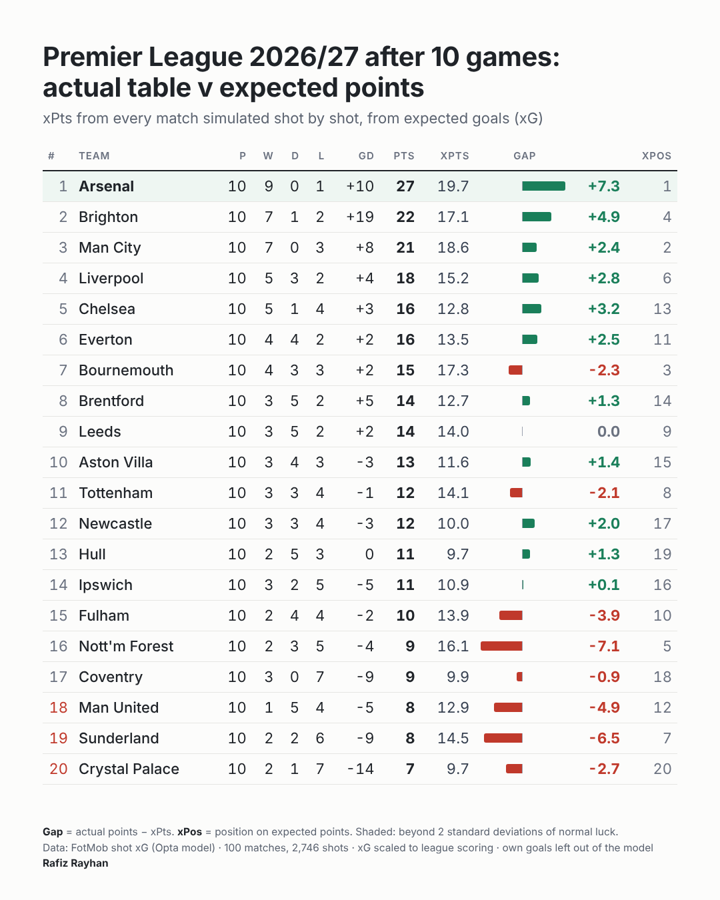
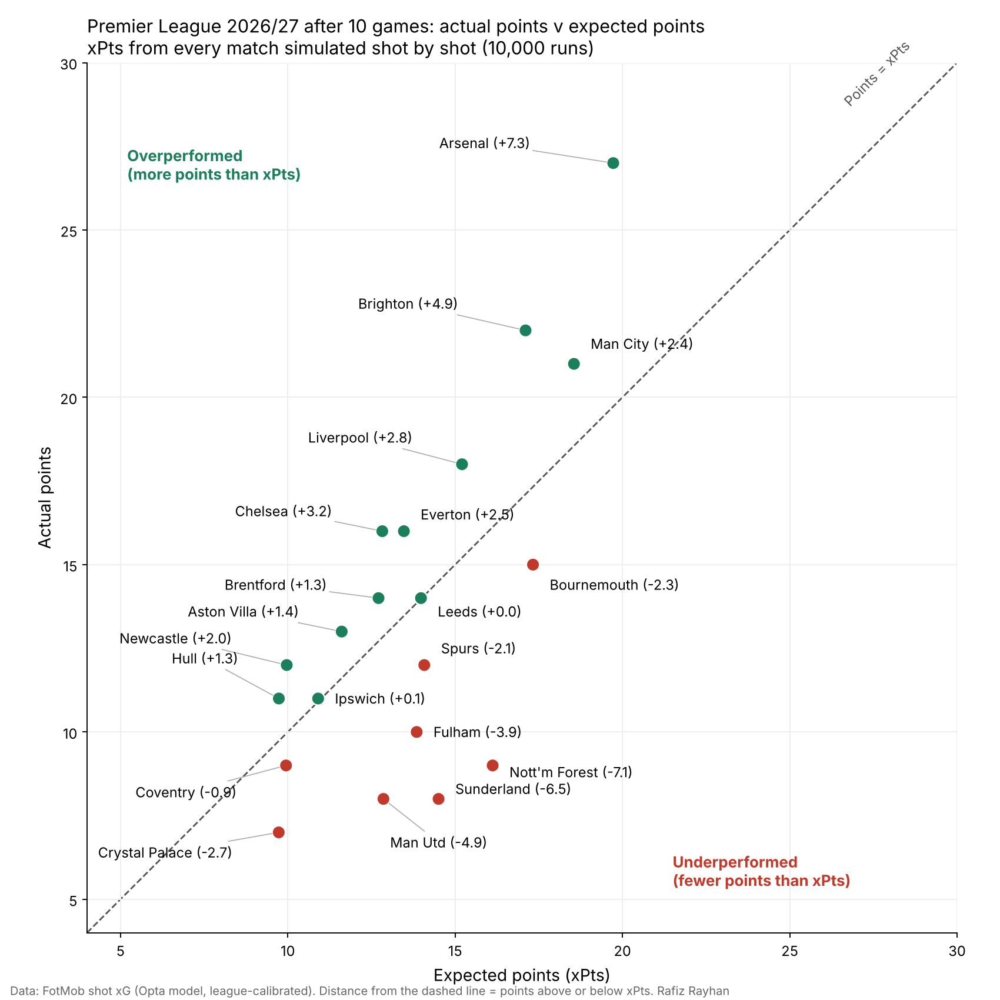

# Premier League 2026/27: who is beating their expected points?

Every Premier League match of 2026/27 so far (10 matchdays, 100 matches) simulated 10,000 times, shot by shot, from expected goals (xG). Each team's expected points (xPts) are then set beside the current league table. This is the follow-up to [Premier League 2024/25: who beat their expected points?](https://github.com/rafizrayhan/epl-xpts-2024-25), using the same method.





## Question

Ten games in, which teams have won more, or fewer, points than the quality of their chances suggests?

## Data

- **Shots:** [FotMob](https://www.fotmob.com) match shot maps, with xG from Opta's model. Understat, used for 2024/25, was offline when this was built, and FBref no longer carries xG.
- **Coverage:** matchdays 1 to 10 (21 August to 9 November 2026): 100 matches and 2,746 shots, each with its own xG.
- **Checks:** shot goals plus own goals reproduce the final score of all 100 matches. The rebuilt table matches the published table after 10 games, from Arsenal (27) to Crystal Palace (7).

The shot files are not included in this repository. `src/s0_download.py` fetches them for personal, non-commercial analysis.

## Method

The same as the 2024/25 project:

1. **Simulate each match 10,000 times.** Every shot is treated as a coin flip that comes up "goal" with probability equal to its xG. Adding up the goals gives one simulated scoreline. Own goals are not shots, so they are left out of the simulation (they still count in the actual results).
2. **Expected points.** For each match, xPts = 3 × P(win) + 1 × P(draw). A team's xPts is the sum over its matches. The figures reported use the exact match probabilities (each side's goal distribution worked out directly from its shots), which is what the simulations estimate, without the simulation noise. The two agree to within 0.07 points per team.
3. **Compare.** Gap = actual points − xPts. After 10 games a team's points vary by about ±3.5 through luck alone (the standard deviation under the model), so the gap is also shown as a z-score.

**One adjustment: league calibration.** Opta's xG for these shots adds up to 294.8, but only 260 goals came from shots. Used as published, it simulates too many goals. Every shot's xG is therefore multiplied by the same factor, 0.882, so total xG equals total goals, as in 2024/25 (0.878). The factor is the same for every team, so it does not favour anyone.

**Checks run in the scripts**
- After scaling, total xG equals the 260 goals from shots.
- The simulated average goals for each team in each match equal its xG, to within simulation noise (0.05).
- The simulation agrees with the exact calculation to within 0.07 points per team.
- Every team has played 10 matches, and the gaps add up to total points minus total xPts.
- Across the 20 teams the z-scores average −0.02 with a spread of 1.04. Pure luck would give 0 and 1, so the model's luck range fits this season.

## Results after 10 games

| Pos | Team | Points | xPts | Gap | z | xPos |
|---|---|---|---|---|---|---|
| 1 | Arsenal | 27 | 19.7 | **+7.3** | +2.0 | 1 |
| 2 | Brighton | 22 | 17.1 | +4.9 | +1.4 | 4 |
| 3 | Manchester City | 21 | 18.6 | +2.4 | +0.6 | 2 |
| 4 | Liverpool | 18 | 15.2 | +2.8 | +0.7 | 6 |
| 5 | Chelsea | 16 | 12.8 | +3.2 | +1.0 | 13 |
| 6 | Everton | 16 | 13.5 | +2.5 | +0.7 | 11 |
| 7 | Bournemouth | 15 | 17.3 | −2.3 | −0.7 | 3 |
| 8 | Brentford | 14 | 12.7 | +1.3 | +0.4 | 14 |
| 9 | Leeds | 14 | 14.0 | 0.0 | 0.0 | 9 |
| 10 | Aston Villa | 13 | 11.6 | +1.4 | +0.4 | 15 |
| 11 | Tottenham | 12 | 14.1 | −2.1 | −0.6 | 8 |
| 12 | Newcastle United | 12 | 10.0 | +2.0 | +0.6 | 17 |
| 13 | Hull | 11 | 9.7 | +1.3 | +0.4 | 19 |
| 14 | Ipswich | 11 | 10.9 | +0.1 | 0.0 | 16 |
| 15 | Fulham | 10 | 13.9 | −3.9 | −1.0 | 10 |
| 16 | Nottingham Forest | 9 | 16.1 | −7.1 | −1.9 | 5 |
| 17 | Coventry | 9 | 9.9 | −0.9 | −0.3 | 18 |
| 18 | Manchester United | 8 | 12.9 | −4.9 | −1.3 | 12 |
| 19 | Sunderland | 8 | 14.5 | −6.5 | −1.9 | 7 |
| 20 | Crystal Palace | 7 | 9.7 | −2.7 | −0.8 | 20 |

xPos = position on expected points.

- **Arsenal** have won 7.3 more points than their chances suggest, the only team beyond two standard deviations. They also have the highest xPts (19.7), so they deserve to be top, just not by this much.
- **Nottingham Forest** (−7.1) and **Sunderland** (−6.5) are the furthest short, both at z = −1.9. Forest's chances would have them 5th rather than 16th, and Sunderland's 7th rather than 19th.
- **Bournemouth** have the third-highest xPts but are 7th. The other way round, **Chelsea** are 5th but 13th on xPts, and **Newcastle** 12th but 17th.
- **Most gaps are still luck-sized.** With 20 teams, about one is expected beyond two standard deviations by chance. After 10 games, only Arsenal is.

## Limitations

- **Early season.** Ten games is a small sample: the normal luck range is about ±3.5 points, so most gaps can still close.
- **Rebounds.** Shot maps list rebounds as separate shots, and the simulation treats every shot as independent. In rare scrambles that lets two shots from one move both score, slightly overstating goals.
- **Game state.** xG reflects how teams played once ahead or behind (for example, sitting deep at 1-0 up). So xPts is a measure of chance quality, not of the points a team "deserved".
- **Own goals.** They are left out of the model, as in 2024/25. Counting them as they happened instead moves some teams by a point or more (Bournemouth most), so the gaps depend a little on this choice.
- **A different xG model from 2024/25.** This season uses Opta's xG via FotMob, not Understat's, so the two seasons' numbers are not directly comparable.

## Reproduce

```bash
pip install -r requirements.txt
python -m playwright install chromium
python src/s0_download.py       # FotMob shot maps for every finished match, into raw/ (5 to 10 minutes)
python src/s1_shots_2627.py     # shots and matches, with checks
python src/s2_simulate.py       # 10,000 simulations per match, with checks
python src/s3_compare.py        # actual v expected points table, with checks
python src/s4_scatter.py        # scatter chart
python src/s5_table.py          # league table image
```

Run `s0_download.py` again after each matchday to add the new matches (saved matches are skipped), then the other steps. The simulation uses a fixed random seed (2627), so results are identical on every run. If the download finds no matches, run it with `--show` to open a visible browser window.

## Repository layout

```
src/    scripts, run in order
data/   final table (other files are created by the scripts in raw/, which is not committed)
out/    league table image and scatter chart
```

## Credits

- Shot data: [FotMob](https://www.fotmob.com), with xG by [Opta](https://theanalyst.com). Used for personal, non-commercial analysis; the raw shot files are not redistributed here.

Author: Rafiz Rayhan ([GitHub](https://github.com/rafizrayhan) | [LinkedIn](https://www.linkedin.com/in/rafiz-rayhan))
